<p align="center">
  
</p>

<p align="center">
  <a href="https://github.com/lobojoel2003/Heirmap/actions/workflows/ci.yml"></a>
  <a href="https://github.com/lobojoel2003/Heirmap/actions/workflows/release.yml"></a>
  <a href="https://github.com/lobojoel2003/Heirmap/releases/latest"></a>
  <a href="packages/intestacy/LICENSE"></a>
  <a href="LICENSE"></a>
  
</p>

**Heirmap** helps families and legal aid attorneys work out who the heirs are, and what share of
the land each one holds, when property has passed down without a will. Build the family tree one
generation at a time, starting from the person named on the deed. An open rules engine applies the
intestacy statute in force on **each date of death** and shows every heir's exact fractional share.
Every fraction is linked to the statute section it came from.

<p align="center">
  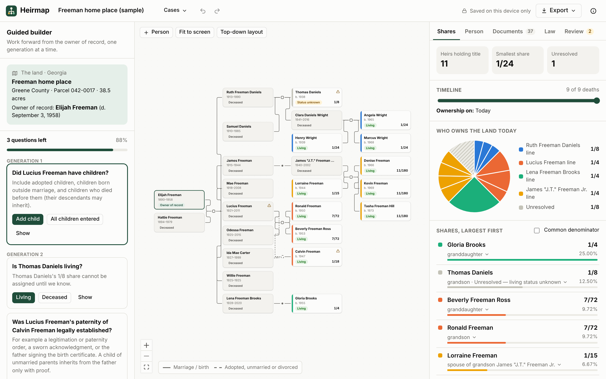
</p>

> [!IMPORTANT]
> Heirmap is a research aid, **not legal advice**. Rules are modeled from the statutes cited in the
> app, and each rule version shows how thoroughly it has been verified. Have an attorney licensed in
> the state where the land is located review any result before relying on it.

## Contents

- [Why Heirmap](#why-heirmap)
- [Features](#features)
- [How it works](#how-it-works)
- [States and rule versions](#states-and-rule-versions)
- [Getting started](#getting-started)
- [Using the rules engine](#using-the-rules-engine)
- [Development](#development)
- [Versioning, builds and releases](#versioning-builds-and-releases)
- [CI/CD](#cicd)
- [Privacy](#privacy)
- [Limitations](#limitations)
- [Contributing](#contributing)
- [License](#license)

## Why Heirmap

When someone dies without a will, their land passes to all of their heirs as co-owners. After two
or three generations, dozens of cousins can each hold a small fraction. Without a clear title,
families cannot get a mortgage, FEMA repair aid or a homestead exemption. Any one heir can also sell
their share to a speculator, who can then force a partition sale of the whole property.

- An April 2026 Urban Institute report puts **$243 billion** of property in tangled or at-risk
  titles, about 3.8% of property owners
  ([Accounting Today](https://www.accountingtoday.com/news/with-wealth-at-risk-how-to-spot-heirs-property-red-flags)).
- The [Lincoln Institute](https://www.lincolninst.edu/publications/land-lines-magazine/articles/understanding-heirs-property/)
  says "hundreds of thousands" of Americans own heirs' property. It ties heirs' property to the loss
  of more than 11 million acres of Black-owned land between 1910 and 1997.
- The [Housing Assistance Council](https://ruralhome.org/wp-content/uploads/2026/02/HAC.RWJF_.-Clarifying-the-Legal-Process-for-Title-Resolution.pdf)
  describes clearing title as slow and paperwork-heavy.

Clearing a title starts with a step families struggle to do alone: working out who the heirs are and
what each one owns under state intestacy law. Commercial tools exist, and legal aid groups often
still draw these charts by hand. Heirmap is free and open source, it runs entirely in the browser,
and an attorney can check every number.

## Features

|                                                                                                                                                                                                                                                                                                                                                                                                                  |                                                                                                    |
| ---------------------------------------------------------------------------------------------------------------------------------------------------------------------------------------------------------------------------------------------------------------------------------------------------------------------------------------------------------------------------------------------------------------- | -------------------------------------------------------------------------------------------------- |
| **Guided family-tree builder.** Heirmap starts with the owner of record and walks forward one generation at a time. It asks only the questions the calculation depends on: marriages, children, dates of death, paternity, estate values. <br><br> **Interactive tree.** Add spouses, children, parents and siblings from any person. Switch between left-to-right and top-down layouts. Undo and redo any edit. | 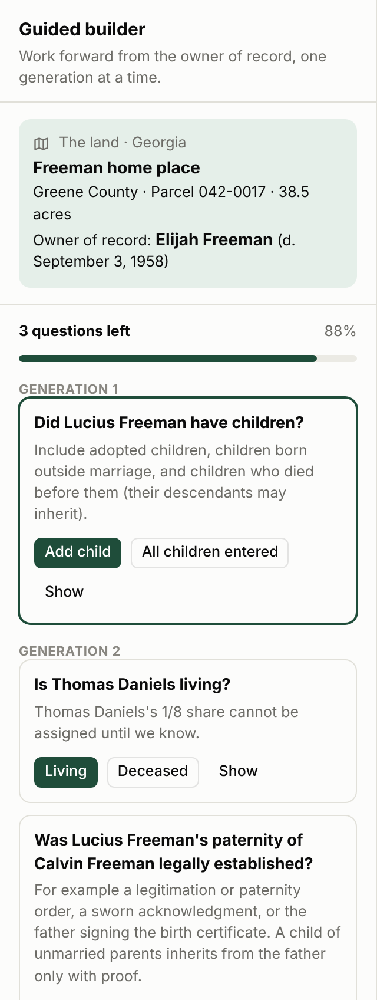              |
| **Shares with their legal basis.** A pie chart grouped by family branch and a ranked table of exact fractions, with an optional common-denominator view. Open any share to see its full chain of title: who died, when, which version of the statute applied, and the quoted statute text with a link to it.                                                                                                     | 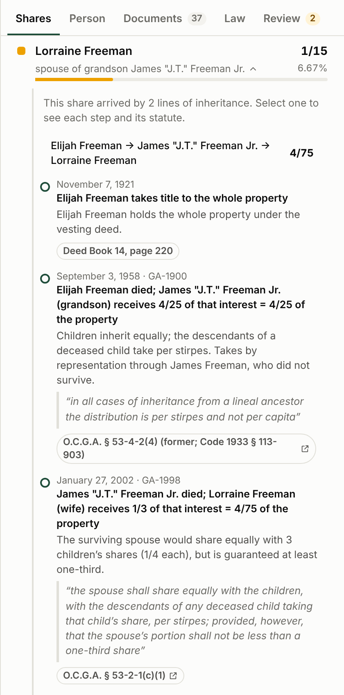 |
| **Dated rule versions.** Each state module carries every version of its intestacy law that Heirmap models. A 1958 death and a 2011 death on the same land are each decided under the law in force at the time. The Law panel shows each version's summary, sources, confidence level and known gaps.                                                                                                             | 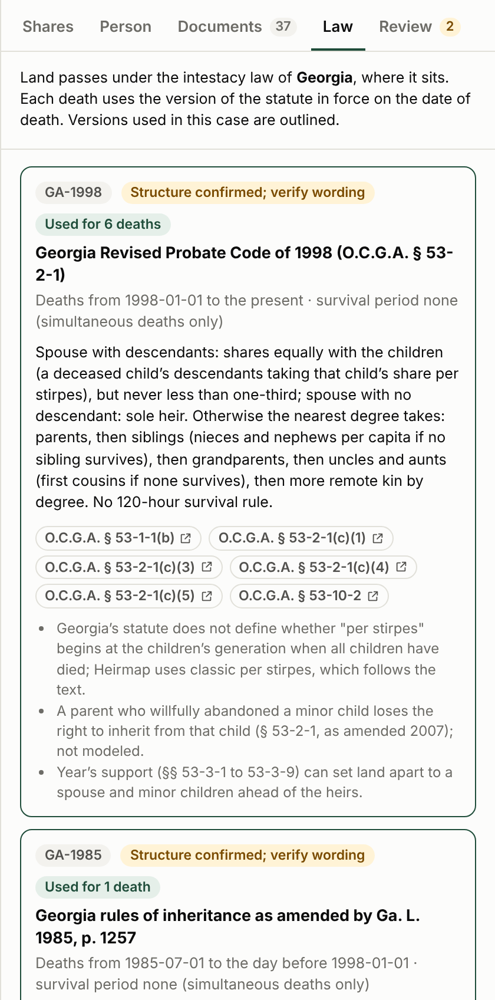   |
| **Document checklist.** Lists the deeds, death certificates, marriage and divorce records, probate searches and paternity proof needed to back up the chain of title. Track each item as needed, requested or obtained, then print it or export it as CSV or Markdown.                                                                                                                                           | 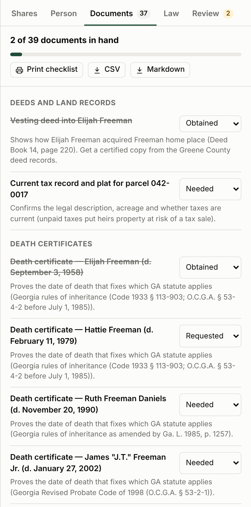                |

**Family chart for an affidavit of heirship.** A printable exhibit with the property description,
the family chart, every heir's undivided interest, the chain of title by death with the statutes
applied, and signature and notary blocks. Print it or save it as a PDF; the chart itself also
exports as SVG.

<p align="center">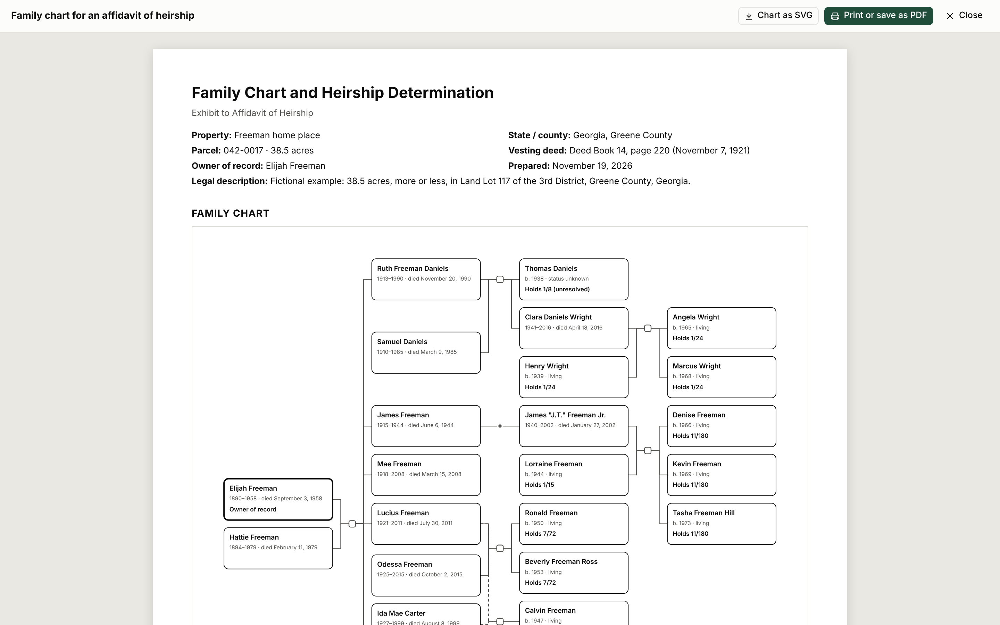</p>

**Timeline.** Drag the slider to see who owned the land after each death in the chain.

<p align="center">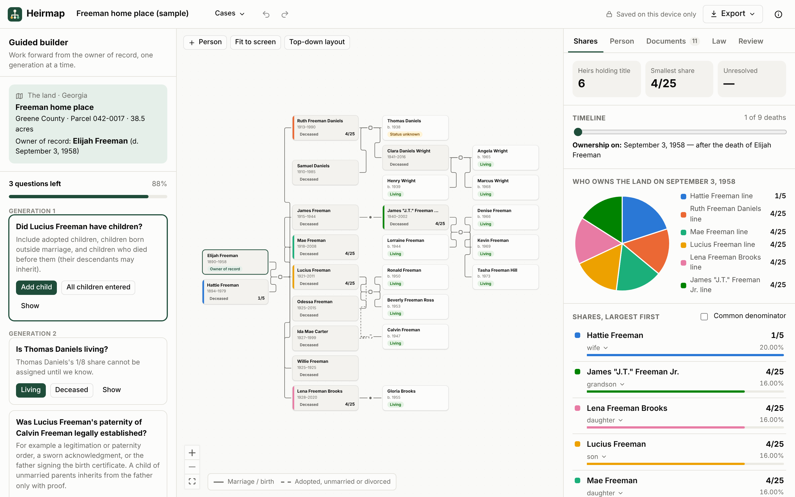</p>

<details>
<summary><strong>More screenshots</strong>: welcome screen, person editor, dark mode</summary>

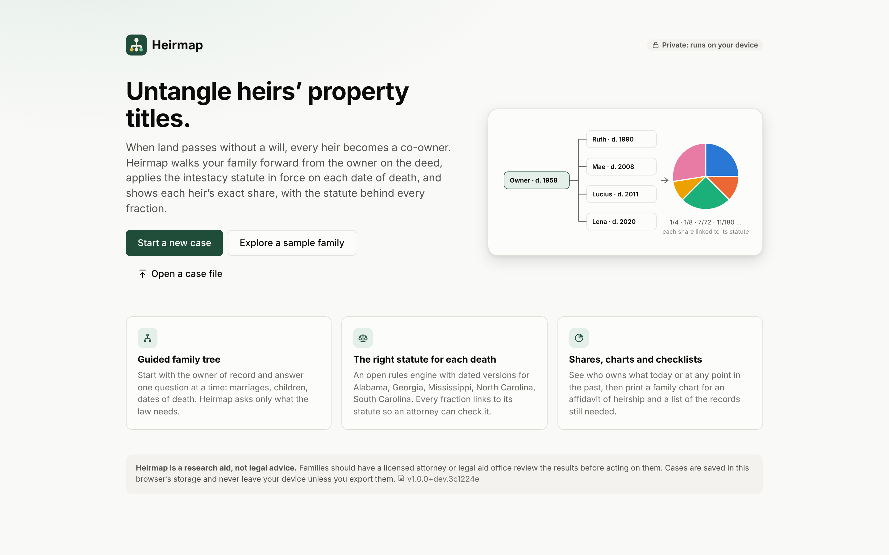
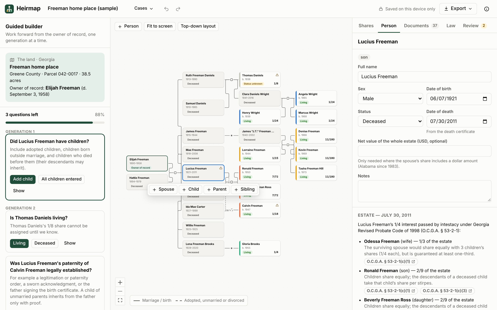
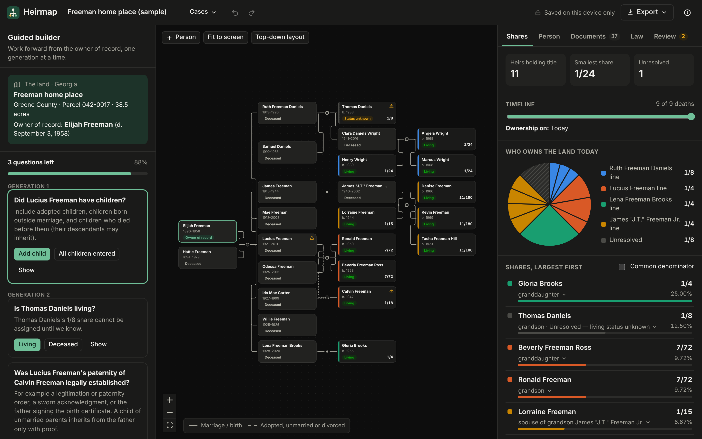

</details>

Heirmap also:

- Never guesses an unknown fact. An heir whose survival or date of death is unknown is shown as
  **unresolved**, and the guide asks for the missing fact.
- Flags anything that needs review: children of unmarried parents without proof of paternity,
  survival near the 120-hour line, common-law marriages after a state's cutoff, rule branches
  modeled from secondary sources, and escheat.
- Handles probated wills, including partial intestacy and lapse, along with disclaimers, slayer
  exclusions, adoption, children adopted out of the family, stepchildren, posthumous heirs, and
  co-owners holding as tenants in common or with right of survivorship.
- Exports and imports a case as a JSON file, so a family can hand its work to a legal aid office.

## How it works

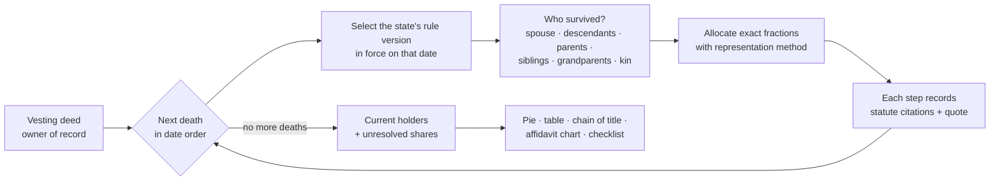

1. **Land follows the law of the place where it sits.** Real property passes under the intestacy
   law of the state where the land is located, so the property's state picks the rules module.
2. **The date of death picks the version.** Each death is decided by the rule version in force on
   that date, such as `GA-1900`, `GA-1985` or `GA-1998`.
3. **Shares are exact.** All arithmetic uses `bigint` fractions, so 11/180 stays 11/180 and the
   holdings always add up to exactly the whole.
4. **Every step leaves a trail.** Each transfer records the decedent, the date, the fraction of
   that person's interest, the resulting share of the property, the rule version, the citations
   and a plain-English explanation. That trail is the chain of title shown in the app and printed
   on the affidavit chart.

## States and rule versions

| State          | Rule version                                      | Deaths                       | Spouse with descendants                  | Representation                 | Confidence |
| -------------- | ------------------------------------------------- | ---------------------------- | ---------------------------------------- | ------------------------------ | ---------- |
| Alabama        | `AL-1900` statute of descents                     | before May 28, 1980          | dower (life estate) only                 | per stirpes                    | low        |
|                | `AL-1980` as amended                              | May 28, 1980 – 1982          | dower only; spouse moved to second place | per stirpes                    | low        |
|                | `AL-1983` Probate Code                            | from Jan 1, 1983             | first $50,000 + ½ balance, or ½          | per capita with representation | medium     |
| Georgia        | `GA-1900` Code 1933 § 113-903 / O.C.G.A. § 53-4-2 | before July 1, 1985          | child's part, at least ⅕ (widow)         | per stirpes                    | medium     |
|                | `GA-1985` Ga. L. 1985, p. 1257                    | July 1, 1985 – 1997          | child's part, at least ¼                 | per stirpes                    | medium     |
|                | `GA-1998` Revised Probate Code § 53-2-1           | from Jan 1, 1998             | equal with children, at least ⅓          | per stirpes                    | medium     |
| Mississippi    | `MS-1900` § 91-1-3 / § 91-1-7                     | before July 1, 1956          | a child's part                           | per stirpes                    | medium     |
|                | `MS-1956` + Simultaneous Death Law                | July 1, 1956 – June 30, 1981 | a child's part                           | per stirpes                    | high       |
|                | `MS-1981` + § 91-1-15 reform                      | from July 1, 1981            | a child's part                           | per stirpes                    | high       |
| North Carolina | `NC-1960` Intestate Succession Act                | July 1, 1960 – Sept 30, 2007 | ½ of land (one child) or ⅓ (two or more) | per capita at each generation  | medium     |
|                | `NC-2007` + 120-hour rule                         | from Oct 1, 2007             | ½ or ⅓ of land                           | per capita at each generation  | medium     |
| South Carolina | `SC-1900` Statute of Distributions                | before July 1, 1987          | ½ (one child) or ⅓                       | per stirpes                    | low        |
|                | `SC-1987` Probate Code                            | July 1, 1987 – 2013          | ½                                        | per capita with representation | medium     |
|                | `SC-2014` Probate Code as revised                 | from Jan 1, 2014             | ½                                        | per capita with representation | medium     |

Confidence levels: **high** means checked against the statute text. **Medium** means the structure
is confirmed but some wording comes from secondary sources. **Low** means the version is modeled from
case law and commentary and needs attorney review. Whenever a computation runs through a low-confidence
branch, the app raises a "needs review" warning that names it. See
[docs/rules.md](docs/rules.md) for the sources behind each version and the open questions.

## Getting started

### Use the hosted app

The `main` branch deploys automatically to GitHub Pages at
**<https://lobojoel2003.github.io/Heirmap/>** once Pages is enabled for the repository. Every
[release](https://github.com/lobojoel2003/Heirmap/releases) also includes
`heirmap-web-<version>.zip`, a static build you can unzip and host anywhere.

### Run it locally

Requirements: Node.js 20.19+ (22 recommended) and pnpm 10 (`corepack enable`).

```bash
git clone https://github.com/lobojoel2003/Heirmap.git
```

```bash
cd Heirmap && pnpm install
```

```bash
pnpm dev
```

Open the URL Vite prints, then choose **Explore a sample family** for a guided tour. The sample is
a fictional Georgia family whose chain of title uses all three Georgia rule versions.

## Using the rules engine

The engine is a standalone, dependency-free TypeScript library, licensed Apache-2.0, in
[`packages/intestacy`](packages/intestacy). Each release attaches it as a tarball
(`heirmap-intestacy-<version>.tgz`).

```ts
import { computeShares, buildDocumentChecklist } from '@heirmap/intestacy';

const tree = {
  people: [
    {
      id: 'elijah',
      name: 'Elijah Freeman',
      sex: 'male',
      status: 'deceased',
      deathDate: '1958-09-03',
    },
    {
      id: 'hattie',
      name: 'Hattie Freeman',
      sex: 'female',
      status: 'deceased',
      deathDate: '1979-02-11',
    },
    { id: 'ruth', name: 'Ruth Daniels', sex: 'female', status: 'living' },
    { id: 'mae', name: 'Mae Freeman', sex: 'female', status: 'living' },
  ],
  parentChild: [
    { id: 'l1', parentId: 'elijah', childId: 'ruth', kind: 'biological' },
    { id: 'l2', parentId: 'hattie', childId: 'ruth', kind: 'biological' },
    { id: 'l3', parentId: 'elijah', childId: 'mae', kind: 'biological' },
    { id: 'l4', parentId: 'hattie', childId: 'mae', kind: 'biological' },
  ],
  unions: [{ id: 'u1', partnerIds: ['elijah', 'hattie'], kind: 'marriage' }],
};

const result = computeShares(tree, {
  name: 'Freeman home place',
  state: 'GA',
  owners: [{ personId: 'elijah' }],
});

for (const h of result.holdings) console.log(h.holder.personId, h.share.toString());
// mae 1/2
// ruth 1/2

const first = result.estates[0].allocations[0];
console.log(first.role, first.share.toString(), first.citations[0].section);
// wife 1/3 § 53-4-2(1) (former; Code 1933 § 113-903)

const checklist = buildDocumentChecklist(tree, result.property, result); // deeds, certificates…
```

See the [library README](packages/intestacy/README.md) for the full API: the data model, results,
provenance paths, the `asOf` option, validation, kinship labels and how to write a state module.

## Development

```text
Heirmap/
├── packages/intestacy/     @heirmap/intestacy: rules engine (Apache-2.0)
│   ├── src/                engine, fractions, family index, representation, checklist
│   │   └── states/         one module per state: al.ts, ga.ts, ms.ts, nc.ts, sc.ts
│   └── test/               scenario tests for every state and rule version
├── apps/web/               @heirmap/web: React + React Flow app (AGPL-3.0)
│   ├── src/                components, model (analysis, layout, guide, exporters), store
│   ├── e2e/                Playwright end-to-end tests
│   └── scripts/            screenshot generator for this README
├── scripts/                packaging, versioning and release-notes scripts
├── docs/                   rules methodology, design notes, images
└── .github/workflows/      CI, release and GitHub Pages deployment
```

| Command                                              | What it does                                                        |
| ---------------------------------------------------- | ------------------------------------------------------------------- |
| `pnpm dev`                                           | Run the app with hot reload                                         |
| `pnpm build`                                         | Build the library (`dist/`) and the app (`apps/web/dist`)           |
| `pnpm test`                                          | Unit tests for both packages (Vitest)                               |
| `pnpm test:coverage`                                 | Unit tests with coverage reports                                    |
| `pnpm test:e2e`                                      | Playwright end-to-end tests (build the app first)                   |
| `pnpm lint` / `pnpm typecheck` / `pnpm format:check` | Static checks                                                       |
| `pnpm check`                                         | All of the above except e2e                                         |
| `pnpm package`                                       | Package `release/`: web zip, library tarball, build info, checksums |
| `pnpm screenshots`                                   | Regenerate `docs/images` from a production build                    |
| `pnpm version:set <x.y.z>`                           | Bump every package and the library's `VERSION` constant             |

The test suite has 94 engine tests (about 97% statement coverage of the library), 21 app unit and
component tests, and 6 Playwright scenarios (one on a phone-sized screen). The scenarios include a check that the app makes no
network requests.

## Versioning, builds and releases

- **Semantic Versioning.** The library, the app and the repository share one version number, so a
  release tag describes the whole project. The library exports it as `VERSION`, and
  `scripts/check-version.mjs` keeps every `package.json`, the `VERSION` constant and the
  changelog in agreement.
- **Build numbers.** Every CI build stamps SemVer build metadata from the workflow run number and
  commit, for example `1.0.0+42.3c1224e`. The app shows it under **About**, and the release assets
  include it in `build-info.json`.
- **Tags.** Each release is an annotated tag `vX.Y.Z` on `main`.
- **Changelog.** [CHANGELOG.md](CHANGELOG.md) follows Keep a Changelog. The release workflow copies
  the matching section into the GitHub release notes.

To cut a release:

```bash
pnpm version:set 1.1.0
```

Then add a `## [1.1.0] - YYYY-MM-DD` section to `CHANGELOG.md`, commit, and push the tag:

```bash
git tag -a v1.1.0 -m "Heirmap v1.1.0" && git push origin main v1.1.0
```

The **Release** workflow checks the versions, lints, typechecks, tests, builds and packages the
project, then publishes a GitHub release with these assets:

| Asset                             | Contents                               |
| --------------------------------- | -------------------------------------- |
| `heirmap-web-<version>.zip`       | The static web app                     |
| `heirmap-intestacy-<version>.tgz` | The rules engine npm package           |
| `build-info.json`                 | Version, build number, commit and date |
| `SHA256SUMS.txt`                  | Checksums for the files above          |

You can also start the workflow by hand from the Actions tab; it then creates the tag itself. If an
`NPM_TOKEN` secret is configured, the workflow also publishes `@heirmap/intestacy` to npm.

## CI/CD

| Workflow                                       | Trigger                         | What it does                                                                                                                             |
| ---------------------------------------------- | ------------------------------- | ---------------------------------------------------------------------------------------------------------------------------------------- |
| [`ci.yml`](.github/workflows/ci.yml)           | pushes to `main`, pull requests | Formatting, lint, typecheck and unit tests with coverage on Node 20 and 22; build and package the artifacts; Playwright end-to-end tests |
| [`release.yml`](.github/workflows/release.yml) | tags `v*.*.*`, manual runs      | Verify, build, package and publish the GitHub release (and npm, when configured)                                                         |
| [`pages.yml`](.github/workflows/pages.yml)     | pushes to `main`                | Build and deploy the hosted app to GitHub Pages                                                                                          |
| [Dependabot](.github/dependabot.yml)           | weekly / monthly                | Dependency and Actions updates                                                                                                           |

GitHub Pages must be enabled once under **Settings → Pages → Build and deployment → Source:
GitHub Actions**. Until then the deploy job skips with a notice instead of failing.

## Privacy

Heirmap is local-first by design. Family records are sensitive, and nothing you enter leaves your
device:

- Cases are saved in your browser's `localStorage` and nowhere else. There is no server, account or
  analytics.
- The production build ships a Content Security Policy with `connect-src 'none'`, so the page
  cannot make network requests. An end-to-end test checks this.
- To move a case between devices or share it with a legal aid office, export the case file (JSON)
  and import it on the other side.

## Limitations

- Heirmap models **intestate succession to land**. It does not model the separate rights that can
  sit on top of it: dower and curtesy (before their abolition), homestead and year's support, a
  spouse's elective life estate, tax liens, adverse possession, or deeds out of the family. The app
  flags these where they matter, and the checklist tells you to search the deed records.
- Older rule versions are modeled from case law and secondary sources where the historical statute
  text could not be checked. Those versions are marked **low** or **medium** confidence, and the
  branches that need review raise warnings.
- Dollar-amount spouse shares (Alabama since 1983) need the net value of the whole estate. Heirmap
  assumes the land is shared pro rata with the rest of the estate.
- Five states are modeled today. Contributions of more states are welcome; see below.

## Contributing

Contributions are welcome, especially new state modules, historical rule versions and corrections
from practitioners. Read [CONTRIBUTING.md](CONTRIBUTING.md) for the workflow and the checklist for
adding a state. Please report security issues privately, as described in
[SECURITY.md](SECURITY.md).

## License

Heirmap has two licenses:

- **Rules engine** ([`packages/intestacy`](packages/intestacy)): [Apache License 2.0](packages/intestacy/LICENSE),
  so courts, legal aid groups and other software can embed it freely.
- **Web app and everything else in the repository**: [GNU Affero General Public License v3.0](LICENSE).
  If you run a modified version of the hosted app for others, you must share your changes.

The sample family in the app is fictional. Statute text is quoted from public law for reference.
